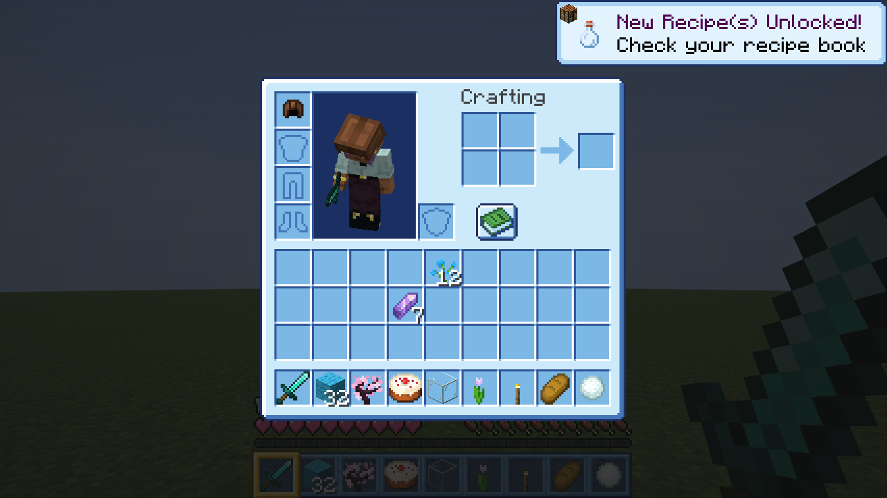
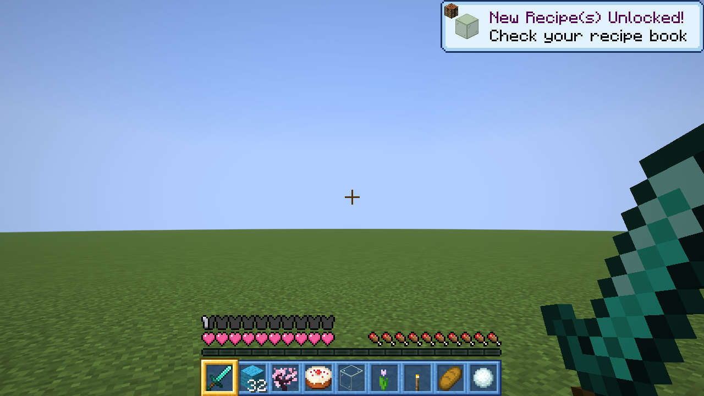
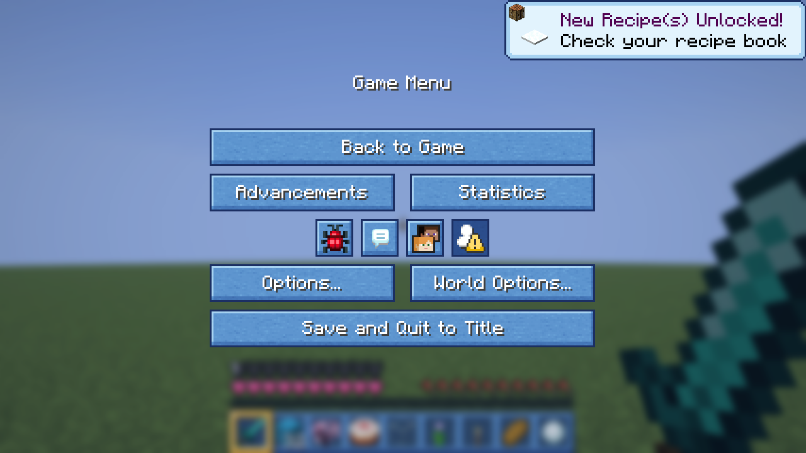

<p align="center"></p>

# Cielo cute

Un paquete de texturas para Minecraft que cambia el gris de los menús por azul cielo. Los bloques y los objetos se quedan igual; solo cambia la interfaz.



## Qué cambia
- **Inventarios celestes**: el tuyo, los cofres, hornos, mesas y demás contenedores.
- **Botones y menús** en azul, con los fondos de los menús en azul noche.
- **Corazones rosados**, también los del modo extremo.
- **Casilla dorada**: la que tienes seleccionada en la barra rápida brilla como una estrella.
- Los avisos (como "receta desbloqueada") y las descripciones de los objetos, a juego.




## Instalación
1. Descarga `cielo-cute-1.0.0.zip` de [Releases](https://github.com/ccrccne/cielo-cute/releases). No hace falta descomprimirlo.
2. En Minecraft ve a **Opciones → Paquetes de recursos → Abrir carpeta de paquetes** y pon el zip ahí.
3. Pásalo a la columna de la derecha y pulsa **Listo**.

Hecho para **Minecraft 26.3**. Funciona junto a otros paquetes; si uno de ellos también cambia la interfaz, deja Cielo cute más arriba en la lista.

## Cómo se hizo
Las texturas salen de un script ([`build.py`](build.py)) que toma las originales del juego y cambia cada tono de gris por su azul equivalente, así el relieve de los botones y las casillas se mantiene. Para volver a generarlas hace falta tener Python y Pillow:
```bash
python build.py <carpeta con las texturas del juego>
```

## Licencia
El script `build.py` es [MIT](LICENSE). Las texturas están basadas en las originales de Minecraft, propiedad de Mojang.

Hecho por **ccrccne** · [ccrccne.github.io](https://ccrccne.github.io)
