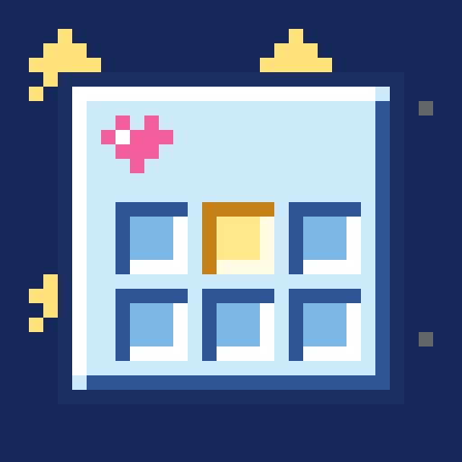
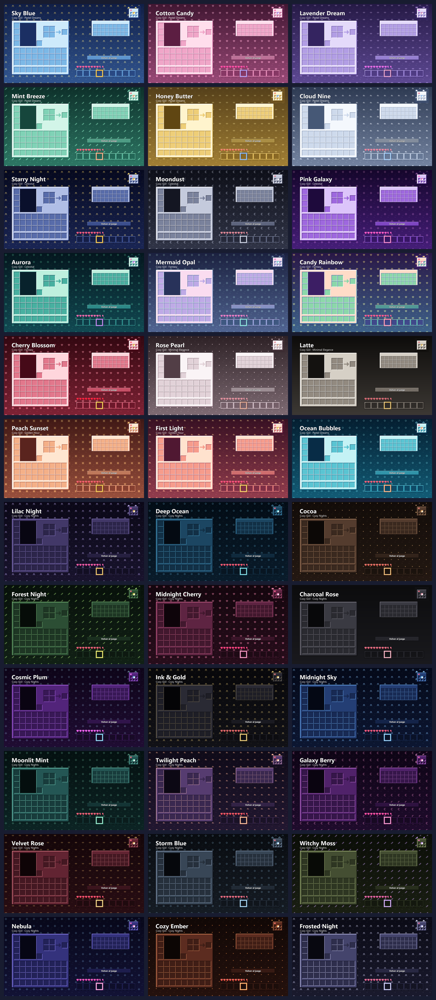

<p align="center"></p>

# Cozy GUI

Un paquete de texturas para Minecraft que cambia el gris de los menús por colores de cielo. Ahora en **36 temas**, claros y oscuros, cada uno con un dibujito en el fondo de los menús. Los bloques y los objetos se quedan igual.



## Qué cambia
- **Inventarios y contenedores**: el tuyo, cofres, hornos, mesas, yunque, aldeanos y demás. Se conserva el relieve; solo cambian los colores.
- **Botones y menús**, con un fondo decorado según el tema (estrellas, corazones, flores, hojas, nubes, burbujas…).
- **Barra rápida** del color del tema y **casilla seleccionada** en un color de acento.
- **Corazones** a juego, también los del modo extremo.
- **Temas oscuros**: además aclaran los títulos de los inventarios para que se lean bien.

## Los temas
| Colección | Temas |
|---|---|
| Pastel Dreams | Sky Blue, Cotton Candy, Lavender Dream, Mint Breeze, Honey Butter, Cloud Nine, Ocean Bubbles |
| Celestial | Starry Night, Moondust, Pink Galaxy, Aurora |
| Fantasy | Mermaid Opal, Candy Rainbow, Cherry Blossom |
| Minimal Elegance | Rose Pearl, Latte |
| Golden Hour | Peach Sunset, First Light |
| Cozy Nights (oscuros) | Midnight Sky, Lilac Night, Deep Ocean, Cocoa, Forest Night, Midnight Cherry, Charcoal Rose, Cosmic Plum, Ink & Gold, Moonlit Mint, Twilight Peach, Galaxy Berry, Velvet Rose, Storm Blue, Witchy Moss, Nebula, Cozy Ember, Frosted Night |

Cada tema es un zip aparte. Para cambiar de tema, activa otro en el menú de paquetes (uno a la vez).

## Instalación
1. Descarga el zip del tema que quieras desde [Releases](https://github.com/ccrccne/cozy-gui/releases). El nombre termina en tu versión: `+26.3` o `+1.21.1`.
2. En Minecraft ve a **Opciones → Paquetes de recursos → Abrir carpeta de paquetes** y pon el zip ahí, sin descomprimir.
3. Pásalo a la columna de la derecha y pulsa **Listo**.

Funciona en **Minecraft 26.3** y **1.21 / 1.21.1** (Java).

## Cómo se hace
Todo sale de dos scripts de Python (necesitan Pillow y NumPy):
- [`themes.py`](themes.py): las paletas, dibujitos y colecciones de cada tema.
- [`build.py`](build.py): toma las texturas originales del juego y genera un zip por tema y versión. Comprueba que los títulos de los inventarios y el texto de los botones sigan siendo legibles.
- [`preview.py`](preview.py): arma las tarjetas de vista previa.

```bash
python build.py <carpeta con 26.3/assets/... y 1.21.1/assets/...>
```

## Licencia
Los scripts son [MIT](LICENSE). Las texturas son recoloreos de las originales de Minecraft, propiedad de Mojang. No es un producto oficial de Minecraft; no está aprobado ni asociado con Mojang o Microsoft.

Hecho por **ccrccne** · [ccrccne.github.io](https://ccrccne.github.io) · [Ko-fi](https://ko-fi.com/ccrccne)
